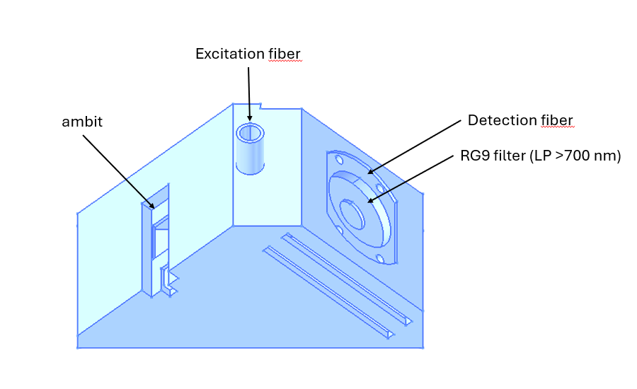

# Quantum yield of PSII measured on intensity and lifetime base.

Plants PSII quantum yield can be estimated by measuring chlorophyll fluorescence before and during a flash of light that saturate photosynthesis.
Chlorophyll fluorescence is normally measured by a fluorimeter by measuring its intensity during a flashlet of light.
It is also possible to measure it using fluorescence lifetime, making the measurement more robust to effect such as chloroplasts movement or change in absorbance.

This repo contains the files and script to run a fluorimeter (Ambit) and a FLIMLab TCSCP setup to measure PSII quantum yield based on intensity and fluorescence lifetime.




## Wiring
- Felix powered with 5V supply, SPAD and laser via 9V supply or external usb-c 
- laser SYNC OUT 1 -> Felix SYNC (channel 0), laser at 80 MHz and 50% intensity
- SPAD SMA -> Felix CH1 (channel 1)
- AMBIT on a USB-serial adapter, 115200 8N1 (DTR/RTS are held low so opening the port
  does not reset the board)


## Measurement approach

The SPAD detector for fluorescence lifetime saturates during the actinic segment (> 3MCPS), therefore during the actinic flash, the ambit light is stopped for a short period (10 ms) allowing the histogram to be acquired.


## Files

| File | Purpose |
| --- | --- |
| `ambit_gate.py` | Library and command line: detect AMBIT, detect Felix, run, align, analyse, save, plot |
| `1_ambit_gate.ipynb` | Step-by-step notebook calling the library |
| `ambit_chop.py` | Chopped AMBIT light + Felix time tags: run, gap finding, micro-times, fits (see below) |
| `chop_sim.py` | Synthetic chopped runs in the Felix TTM format, to test `ambit_chop` without hardware |
| `2_ambit_chop.ipynb` | Step-by-step notebook for the chopped-light measurement (`SIMULATE = True` runs it offline) |
| `blank_dose.py` | Blank and laser-dose tests: Felix histogram recordings, AMBIT blank correction, laser-on transient |
| `3_blank_laser_dose.ipynb` | Step-by-step notebook for the blank (no leaf) and the laser-dose test |
| `ambit_pause.py` | Actinic pauses: ordinary arrun lines with dark pauses, Felix 5 ms histograms, SPAD recovery and decays per pause |
| `4_ambit_gate_2.ipynb` | Step-by-step notebook for the actinic-pause run |
| `reconv.py` | IRF reconvolution fit (2 exponentials, whole decay with its rise, Poisson likelihood) and its plot |
| `runs/<timestamp>/` | Output of each run (ignored by git) |

## Requirements

Python 3.13 with `pyserial`, `numpy`, `matplotlib`, `scipy` (for the tail fit through
`flimgui/fitting.py`) and `pylibtdc` (cp313 wheel from `docs/pylibtdc-2026-09-01.zip`).
Close TDC-Software first: only one program can open the Felix.

## phi2 GUI

The measurement of notebook 4 with its results and the upload to openJII, as a desktop app
(`scripts/ambit-gate/phi2gui`). Two ways to run it:

- **Standalone build** (no Python needed): download `phi2gui-v<version>-win64.zip` from the
  [Releases page](https://github.com/Jan-IngenHousz-Institute/tcscp-ambit-flimlab/releases),
  extract the whole zip, double-click `phi2gui\phi2gui.exe`, see the `README.txt` inside. With the
  Felix plugged in, the app offers to install its WinUSB driver on first use (administrator prompt
  once, then a two-click wizard). The IRF of `irf-library/` is shipped as the default; "Add IRF file..."
  takes another TDC-Software export. Every run gets a "Raw data" tab (and `raw.png`), also when the
  fits fail, and a run is refused when the Felix window is longer than half a pause. It bundles
  TEDIEL's `pylibtdc` (the free download from [tediel.com/resources](https://tediel.com/resources));
  a Felix with a valid licence is still needed. Build it with `build_phi2gui.bat`.
- **From source**: clone or download this repository, install the requirements above, then
  double-click `phi2gui.bat` in the repository folder (or `python -m phi2gui` from
  `scripts/ambit-gate`). The GitHub release's "Source code" zip is this, not the standalone build.


## Use

```
cd scripts/ambit-gate
python ambit_gate.py --check            # detect both, print count rates
python ambit_gate.py                    # default protocol, plot, save under runs/
python ambit_gate.py --port COM5 --window 0.05 --threshold 1.0 --out C:\data\flash01
```

Default protocol (edit `DEFAULT_PROTOCOL` or the notebook cell):

| Segment | Line | Meaning |
| --- | --- | --- |
| 1 | `2,0,0,10,0,10,0,0` | 10 samples at 10 Hz, LED off (1 s dark) |
| 2 | `2,0,0,10,0,10,250,0` | 10 samples at 10 Hz, LED at 250 mA (1 s flash) |
| 3 | `2,0,0,30,0,10,0,0` | 30 samples at 10 Hz, LED off (3 s relaxation) |

Type 2 lines do not fire the 730 nm reference LED, so only the 625 nm measuring pulses
(about 70 µs each) reach the SPAD in the dark phases; they add a flat, negligible background.

## Output

- `ambit.csv`: time since sample 0, `s_630`, `r_630`, ratio, actinic current
- `felix_windows.csv`: one row per window with phase, total counts, mean arrival time
  after the peak (`tau_mean_ns`, model free) and a one-exponential tail fit (`tau_fit_ns`)
- `felix_windows.npz`: the full bins matrix for your own analysis
- `decay_pre.csv`, `decay_post.csv`: summed decays before and after the flash
- `run.json`: protocol, alignment mode and latency, count rates, instrument identities
- `summary.png`: the four-panel figure

